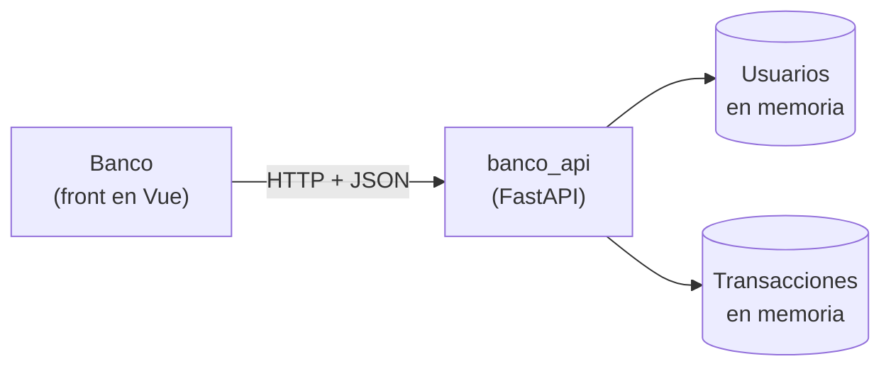
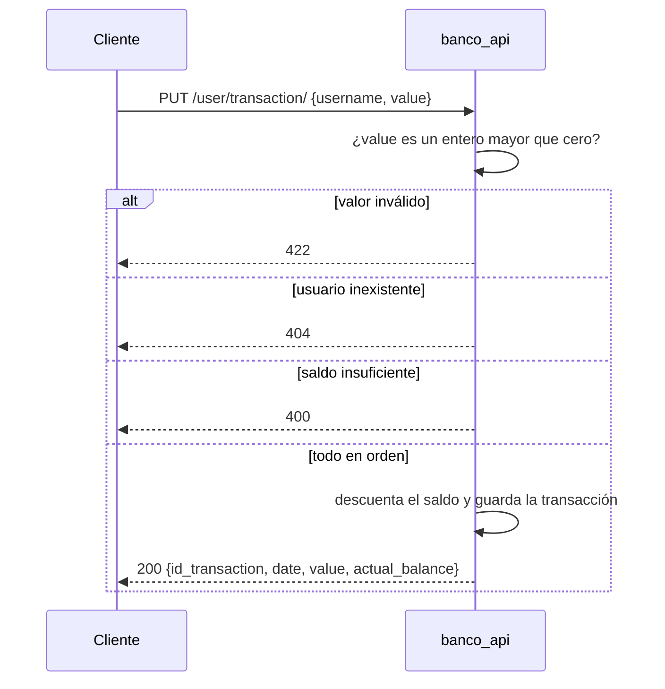

# banco_api

API de ejemplo de un banco hecha con FastAPI: autenticación, consulta de saldo y retiros sobre una base de datos en memoria. Es el backend de [Banco](https://github.com/juandavidalvarez9/Banco), el front en Vue.



## Endpoints

| Método | Ruta | Qué hace | Errores |
|---|---|---|---|
| `POST` | `/user/auth/` | Valida usuario y contraseña. Responde `{"Autenticado": true}` o `false` | `404` si el usuario no existe |
| `GET` | `/user/balance/{username}` | Devuelve el saldo del usuario | `404` si el usuario no existe |
| `PUT` | `/user/transaction/` | Registra un retiro y devuelve la transacción con el saldo actualizado | `400` sin fondos suficientes, `404` usuario inexistente, `422` valor que no sea un entero mayor que cero |

Así se procesa un retiro:



## Cómo ejecutarla

Requiere Python 3.11 o superior.

```bash
python -m venv .venv
source .venv/bin/activate        # En Windows: .venv\Scripts\activate
pip install -r requirements.txt
uvicorn main:api --reload
```

La documentación interactiva queda en <http://127.0.0.1:8000/docs>.

Usuarios de prueba:

| Usuario | Contraseña | Saldo inicial |
|---|---|---|
| `camilo24` | `root` | 120000 |
| `andres18` | `hola` | 34000 |

Ejemplo:

```bash
curl http://127.0.0.1:8000/user/balance/camilo24
# {"username":"camilo24","balance":120000}

curl -X PUT http://127.0.0.1:8000/user/transaction/ \
  -H "Content-Type: application/json" \
  -d '{"username": "camilo24", "value": 1000}'
# {"id_transaction":1,"username":"camilo24","date":"...","value":1000,"actual_balance":119000}
```

## Configuración

| Variable | Para qué sirve | Valor por defecto |
|---|---|---|
| `ALLOWED_ORIGINS` | Orígenes, separados por comas, desde los que un navegador puede llamar la API (CORS) | `http://localhost:5173,http://127.0.0.1:5173` |

## Pruebas

```bash
pip install -r requirements-dev.txt
pytest
```

## Límites

- Los datos viven en memoria: se reinician al reiniciar el servidor y no se comparten entre procesos, así que debe ejecutarse con un solo proceso.
- Las contraseñas de los usuarios de prueba están en texto plano y la autenticación solo responde verdadero o falso: no emite sesión ni token. Sirve como demostración, no como base de un sistema real.
- Solo hay retiros; no hay consignaciones ni transferencias.

## Licencia

Ver [LICENSE](LICENSE).
